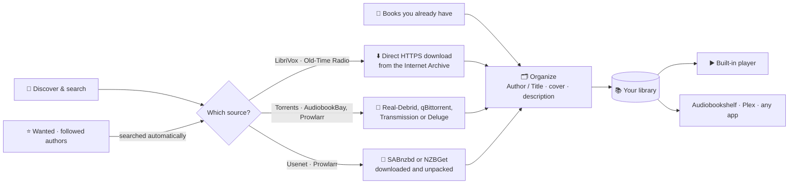

<div align="center">


# Narratarr

**Your audiobooks: found, fetched, and playing.**

An \*arr-style audiobook manager with a built-in player.<br>
Discover a book, click once, and it lands in your library, tagged, organized and ready to listen to.

[](https://github.com/narratarr/narratarr/actions/workflows/ci.yml)
[](https://github.com/narratarr/narratarr/pkgs/container/narratarr)
[](pyproject.toml)
[](LICENSE)

[**Install**](#-install) · [**Features**](#-features) · [**How it works**](#-how-it-works) · [**Configuration**](#%EF%B8%8F-configuration) · [**FAQ**](#-faq)

<br>


</div>

<br>

## ✨ Features

<table>
<tr>
<td width="50%" valign="top">

### Discover
Browse more than 30,000 free, legal audiobooks and radio shows from **LibriVox** and **Old-Time Radio**. You can explore by genre, see what's most popular or newest, and filter by language and format.

</td>
<td width="50%" valign="top">

### Search that forgives typos
Search for `sherlok holms` and you still get Sherlock Holmes. Titles suggest themselves as you type, results are ranked by how well they match, and there's always a way back to your exact words.

</td>
</tr>
<tr>
<td></td>
<td></td>
</tr>
<tr>
<td width="50%" valign="top">

### One click to your library
Every book shows its length, format, size and description before you commit. Downloads are queued, tracked live on the **Activity** page, and filed into your library as `Author/Title`, with cover art and description included.

</td>
<td width="50%" valign="top">

### A real player, built in
No other app needed. You get chapters (including the chapter markers inside `.m4b` files), speeds from 0.75× to 3×, and a sleep timer that can stop at the end of the chapter. It remembers your place in every book, and lock-screen and headphone controls work too.

</td>
</tr>
<tr>
<td></td>
<td></td>
</tr>
</table>

<table>
<tr>
<td width="62%" valign="top">

### Made to be lived in
- **Continue listening** shelf and finished-book tracking
- Looks at home on a **phone**: add it to your home screen and listen anywhere on your Wi-Fi
- **Light and dark** themes that follow your system
- Plugs into your **\*arr stack**: **Prowlarr** (or any **Torznab** indexer, such as **Jackett**) for search; **SABnzbd** or **NZBGet** for Usenet; **qBittorrent**, **Transmission**, **Deluge** or Real-Debrid for torrents
- **Wanted list** that fills itself: follow **authors and series** and new releases are found and downloaded automatically
- **Import** the audiobooks you already have, or point it at an existing Audiobookshelf library
- **Audiobookshelf** in a click: Narratarr finds your server (on this machine, in Docker, across your network, or at a public address), you sign in once, and it rescans after every download
- **Accounts for the whole household**: admins run things, listeners browse, request and listen, and everyone keeps their own place in every book
- **Pluggable sources**: adding a new catalog is one small Python class

<br>


</td>
<td width="38%" valign="top" align="center">

</td>
</tr>
</table>

<br>

## 🚀 Install

Pick whichever suits you. All of them end with Narratarr running at **http://localhost:8484**.

### Option 1: The guided installer (macOS & Linux)

Paste this into a terminal:

```bash
curl -fsSL https://raw.githubusercontent.com/narratarr/narratarr/main/install.sh | bash
```

It asks a few friendly questions: Docker or native, where your books should go, and whether Narratarr should start when you log in. Then it does the rest. If needed it installs [uv](https://docs.astral.sh/uv/) first (it asks before doing so). uv brings its own Python, so nothing else on your system changes.

<table>
<tr>
<td width="50%" valign="top"><sub><b>Pick how to run it</b> (arrow keys, enter)</sub><br><br></td>
<td width="50%" valign="top"><sub><b>…and a few steps later</b></sub><br><br></td>
</tr>
</table>

<details>
<summary><b>Installer options</b> (for scripts and servers)</summary>

```bash
curl -fsSL https://raw.githubusercontent.com/narratarr/narratarr/main/install.sh | bash -s -- --docker --yes
```

| Option | What it does |
| --- | --- |
| `--docker` / `--native` | Skip the first question |
| `--library PATH` | Where finished books go (default `~/Audiobooks`) |
| `--port N` | Web UI port (default `8484`) |
| `--dir PATH` | Docker only: where `docker-compose.yml` and settings live (default `~/narratarr`) |
| `--autostart` / `--no-autostart` | Native only: start at login with launchd (macOS) or a systemd user service (Linux) |
| `-y`, `--yes` | Accept defaults, ask nothing |
| `--uninstall` | Remove Narratarr. Your audiobooks and settings are kept |

To **update**, run the same install command again.

</details>

### Option 2: Docker Compose

Images are published for `linux/amd64` and `linux/arm64`, so they work on Intel and Apple Silicon machines, a Raspberry Pi 4/5 or a NAS.

```yaml
services:
  narratarr:
    image: ghcr.io/narratarr/narratarr:latest
    container_name: narratarr
    restart: unless-stopped
    ports:
      - "8484:8484"
    environment:
      - PUID=1000          # run `id -u` to find yours
      - PGID=1000          # run `id -g` to find yours
      - TZ=Etc/UTC
    volumes:
      - ./config:/config            # settings + library database
      - ~/Audiobooks:/audiobooks    # where finished books go
```

```bash
docker compose up -d
```

Like the other \*arr images, the container runs as `PUID:PGID`, so the files it writes belong to you, not to root.

<details>
<summary><b>Plain <code>docker run</code></b></summary>

```bash
docker run -d --name narratarr --restart unless-stopped \
  -p 8484:8484 \
  -e PUID=$(id -u) -e PGID=$(id -g) \
  -v "$PWD/config:/config" \
  -v "$HOME/Audiobooks:/audiobooks" \
  ghcr.io/narratarr/narratarr:latest
```

</details>

### Option 3: With uv, or from source

```bash
uv tool install git+https://github.com/narratarr/narratarr
narratarr                     # → http://127.0.0.1:8484
```

```bash
git clone https://github.com/narratarr/narratarr && cd narratarr
uv sync && uv run narratarr
```

> **Windows:** use [Docker Desktop](https://www.docker.com/products/docker-desktop/) with the Compose file above. Running from source with uv works on Windows too.

<br>

## 🎧 Your first five minutes

1. Open **http://localhost:8484**. You land on **Discover**, showing LibriVox's most popular books.
2. Search for something, or tap a genre like **Mystery** or **Sci-Fi**.
3. Open a book and press **Download**. You can watch its progress on the **Activity** page.
4. When it's done, find it in your **Library** and press ▶︎.
5. *(Optional)* Already have audiobooks? **Library → Import books** brings them in.
6. *(Optional)* In **Settings**, choose your library folder, connect Prowlarr and your download clients, or turn on Audiobookshelf.

<br>

## 🧭 How it works



| Step | What happens |
| --- | --- |
| **Queue** | Books you add wait in a queue (2 at a time by default). Interrupted downloads pick up again when the app restarts. |
| **Fetch** | Free sources download straight over HTTPS. Torrents go through [Real-Debrid](https://real-debrid.com) (nothing is shared from your machine) or your own qBittorrent, Transmission or Deluge. Usenet releases go to your SABnzbd or NZBGet, and Narratarr picks up the files when it has finished unpacking. |
| **Organize** | Archives are unzipped safely, files move into `{author}/{title}` (configurable), and `cover.jpg`, `desc.txt` and `reader.txt` are written next to them, the layout Audiobookshelf expects. |
| **Listen** | The player treats a book as one timeline, whether it's a single `.m4b` or 40 `.mp3` parts, and streams it to any browser with seeking. |

### Sources

| Source | What's there | How it downloads |
| --- | --- | --- |
| **LibriVox** | ~22,000 public-domain audiobooks read by volunteers: Austen, Doyle, Dickens, Poe, Twain… | Free, direct from the Internet Archive |
| **Old-Time Radio** | ~9,000 classic radio dramas and comedies, 1930s–60s | Free, direct from the Internet Archive. Some full series are several GB, and the size is shown before you download |
| **AudiobookBay** *(optional)* | Torrent listings | Via Real-Debrid (paid account required) |
| **Prowlarr** *(optional)* | Whatever indexers you've added to your own [Prowlarr](https://prowlarr.com) | Usenet via SABnzbd or NZBGet; torrents via Real-Debrid, qBittorrent, Transmission or Deluge |
| **Torznab** *(optional)* | Any indexer that speaks Torznab: [Jackett](https://github.com/Jackett/Jackett), Prowlarr's Torznab endpoint, or a standalone indexer. Give it the address ending `/torznab/api` and the key | Same as Prowlarr |
| **Audible catalog** *(with Prowlarr)* | Every audiobook in Audible's store, with covers, series and release dates | Nothing downloads from Audible: books go to **Wanted** and Narratarr finds them on your indexers (or free on LibriVox) |

Narratarr deliberately sticks to the Internet Archive's **curated** LibriVox and Old-Time Radio collections. The Archive's general uploads include copyrighted audiobooks posted without permission, so those are left out.

<a id="prowlarr-and-sabnzbd"></a>

### Your \*arr stack: Prowlarr and download clients

Already running an \*arr stack? Narratarr searches the indexers in your Prowlarr and hands downloads to your own clients, the same way Sonarr and Radarr do.

| Settings section | Choose | Where to find what it asks for |
| --- | --- | --- |
| **Prowlarr** | | Address (e.g. `http://localhost:9696`) and the API key from *Prowlarr → Settings → General* |
| **Usenet** | **SABnzbd** | Address (e.g. `http://localhost:8080`) and the API key from *Config → General* |
| | **NZBGet** | Address (e.g. `http://localhost:6789`) plus its ControlUsername / ControlPassword from *Settings → Security* |
| **Torrents** | **Real-Debrid** | API key from [real-debrid.com/apitoken](https://real-debrid.com/apitoken). Nothing is shared from your machine |
| | **qBittorrent** | Web UI address, username and password. Torrents get an `audiobooks` category |
| | **Transmission** | Address (e.g. `http://localhost:9091`), plus a username and password if you set one |
| | **Deluge** | Web UI address (e.g. `http://localhost:8112`) and its password. Deluge has no username. Torrents are labelled `narratarr-<book id>` when the Label plugin is enabled |

Press **Test** next to each one. Once Prowlarr is connected, a **Prowlarr** tab (and an **Audible catalog** tab) appears on Discover. Each Prowlarr result shows its indexer, size, format, and whether it's Usenet or a torrent. Open one and Narratarr matches the release name to the real book, so it's filed under the right author and title, with cover art.

**What happens after you press Download:**

- **Usenet:** the NZB goes to SABnzbd or NZBGet. When it has downloaded, repaired and unpacked the release, Narratarr moves the files into your library and clears the job from the client's history.
- **qBittorrent / Transmission / Deluge:** when the torrent finishes, Narratarr **hard-links** the files into your library (copying only if they're on different drives). The torrent keeps seeding, which matters on private trackers.
- **Stop or Remove** in Narratarr also removes an unfinished download from the client.

Narratarr searches category `3030` (*Audio › Audiobook*) by default; you can add more under **Settings → Prowlarr**. To go easy on indexer API limits, each search is sent once as typed, and a second, spelling-corrected search is only made when the first finds little.

> [!TIP]
> **Running it all in Docker?** Narratarr needs to see your clients' finished downloads. Mount the same host folder into every container, ideally at the same path:
>
> ```yaml
> services:
>   narratarr:
>     volumes:
>       - /data/downloads:/data/downloads   # same path as in your download clients
>   sabnzbd:            # or nzbget / qbittorrent / transmission
>     volumes:
>       - /data/downloads:/data/downloads
> ```
>
> If the paths have to differ (say the client uses `/downloads` and Narratarr uses `/data/downloads`), fill in **Settings → Download folders → Path mapping**. Use your containers' names as the addresses, e.g. `http://prowlarr:9696`.
>
> **qBittorrent in Docker:** keep `WEBUI_PORT` the same as the port you publish (e.g. `8080:8080`). qBittorrent refuses connections that arrive on a different port.

### Wanted books and following authors

Some books aren't out yet, or aren't on your indexers yet. Put them on your **Wanted** list and Narratarr keeps looking for you.

- **Add any book:** the **Audible catalog** tab on Discover browses and searches Audible's whole store, including bestsellers, new releases, genres and books that haven't come out yet. Press **Add to Wanted**. Nothing is downloaded from Audible; it's only used for the book's details.
- **Automatic search:** Narratarr checks your Prowlarr indexers, and LibriVox for public-domain titles, every 12 hours (adjustable). It only grabs a release when both the title *and* the author match, preferring free LibriVox recordings, M4B files and torrents with seeders. A few books are checked at a time to stay within your indexers' API limits, and books that aren't released yet wait until their release date.
- **Pick a release yourself:** open a Wanted book and press **Pick a release** to see every match with a score, then **Grab** the one you want. The book keeps Audible's title, cover and description whichever release you pick.
- **Follow authors and series:** on the **Authors** page, search for an author and press **Follow**, or press **Follow** on any book's author or series. Their new releases (and, if you like, everything already out) go straight to Wanted. Each author and series page shows their books, what's in your library, and an **Add all missing** button.

### Importing books you already have

**Library → Import books** scans any folder on the computer running Narratarr. Each folder of audio files becomes one book (`CD1`/`Disc 2` sub-folders stay together), named from the files' tags or from the folder names (`Author/Title` or `Author - Title`). Check the names, fix any, then choose:

- **Copy in:** copies them into your library, organized as `Author/Title`, and leaves the originals alone.
- **Move in:** the same, but moves them.
- **Leave where they are:** adds them without touching the files. Use this for an existing Audiobookshelf or Plex library.

Cover art embedded in the audio files is saved as `cover.jpg`. For hands-off imports, set an **import folder** under **Settings → Import**: anything dropped there is moved into your library automatically, once it has finished copying.

<br>

## ⚙️ Configuration

Most things live on the **Settings** page: library folder, folder template, how many downloads run at once, search options, Prowlarr, download clients, automatic search, the import folder and Audiobookshelf. Secrets are stored in a `chmod 600` file and never sent back to the browser in full.

A few things are set with environment variables instead:

| Variable | Default | Purpose |
| --- | --- | --- |
| `NARRATARR_PORT` | `8484` | Web UI port (`--port` works too) |
| `NARRATARR_HOST` | `127.0.0.1` (`0.0.0.0` in Docker) | Address to listen on. Use `0.0.0.0` to reach it from other devices |
| `NARRATARR_DATA` | `~/.narratarr` (`/config` in Docker) | Settings and library database |
| `NARRATARR_LIBRARY` | `~/Audiobooks` (`/audiobooks` in Docker) | Default library folder for new installs |
| `NARRATARR_PASSWORD` | *(none)* | Before 0.5.5 this was a single shared password. If it's set when you upgrade, it becomes the password of an admin account called `admin`; after that it's ignored |
| `NARRATARR_HOSTS` | *(none)* | Extra hostnames Narratarr should answer to, comma-separated (`books.example.com, *.home.example`). IP addresses, plain machine names and `.local` / `.lan` / `.home` / `.internal` / `.ts.net` names always work; anything else is refused to block DNS-rebinding attacks |
| `PUID` / `PGID` | `1000` | Docker only: the user and group files are written as |

### Accounts

Everyone signs in. The installer asks for the first account, the **admin**; if you skipped it (or updated from before 0.5.5), the first time you open Narratarr it asks you to create one. Opened from another network, that first screen also wants the **setup code** Narratarr printed when it started (`docker logs narratarr`, or `~/.narratarr/narratarr.log`), so nobody else can claim a fresh install.

Add people under **Settings → Users**:

| Role | Can |
| --- | --- |
| **Admin** | Everything: settings, download clients, imports, removing books, and managing users |
| **Listener** | Browse, search, request and download books, follow authors, and listen. Each listener has their own place in every book and their own Continue listening shelf |

Everyone can change their own password from the account button at the bottom of the sidebar. Forgot the admin password? Reset it from a terminal on the machine running Narratarr:

```bash
narratarr users passwd <name>                              # native install
docker exec -it -u "$(id -u):$(id -g)" narratarr narratarr users passwd <name>    # Docker
```

`narratarr users` also has `add`, `list`, `role` and `remove`.

### Listening on your phone

Start Narratarr so other devices can reach it (Docker already does), then open `http://<your-computer's-IP>:8484` on your phone while it's on the same Wi-Fi. Use **Add to Home Screen** for an app-like icon. Phones stay signed in for 30 days.

> [!IMPORTANT]
> Narratarr is built for your home network. Don't expose it directly to the internet. If you want remote access, put it behind a VPN such as Tailscale or WireGuard, or behind a reverse proxy with proper authentication, and add the proxy's hostname to `NARRATARR_HOSTS`.
>
> Everyone signs in, so a stranger who reaches the port gets a sign-in screen and nothing else. **Don't ask for a password on my home network** (Settings → Users) skips sign-in for this machine and your LAN; leave it off if Narratarr can be reached from the internet.

### What leaves your machine

Narratarr has no telemetry and phones nobody. These are the only outside services it contacts, and when:

| Service | What it receives | When |
| --- | --- | --- |
| **archive.org** | Your LibriVox / Old-Time Radio searches, and the titles of Wanted books during automatic searches | Using those tabs; automatic search |
| **Apple's audiobook search** (itunes.apple.com) | What you type in the search box, and Prowlarr release names (to work out the real title) | Only while **Smart search** is on |
| **Audible's catalog** and **Audnexus** (api.audnex.us) | Your searches on the Audible tab, and the authors and series you follow | Using the Audible tab; following |
| **Brave Search** | Your searches, with your Brave key | Only if you turn it on |
| **Real-Debrid**, **Prowlarr**, **SABnzbd**, **NZBGet**, **qBittorrent**, **Transmission**, **Deluge**, **Torznab**, **Audiobookshelf** | Whatever each needs, with the key you entered for it | Only the ones you set up |
| **Cover image hosts** (archive.org, Amazon's image CDN, your indexers) | Nothing but the image request, with no referrer | Your browser loads cover art directly |
| **GitHub** (api.github.com) | Nothing but the request for the latest release | Once a day, for the update badge. Off under Settings → Updates |

Fonts are bundled, so the UI itself never contacts a CDN. Torrents downloaded through **qBittorrent, Transmission or Deluge** expose your IP address to other peers, as with any torrent client; Real-Debrid doesn't.

<br>

## 🔍 Smart search, in detail

- **Typos fixed:** your words are checked against Apple's public audiobook catalog and corrected before searching. *"Including results for sherlock holmes · Show only close matches for 'sherlok holms'"*
- **Suggestions as you type**, with covers.
- **Several result pages fetched at once** and re-ranked by how well each title and author matches what you typed.
- **Filters** for language and format, plus sorting by best match, newest, size or title.

Smart search sends what you type to Apple's public search API. You can turn it off under **Settings → Source**.

<br>

## ❓ FAQ

<details>
<summary><b>Do I need Real-Debrid?</b></summary>

No. LibriVox and Old-Time Radio download directly and for free. Usenet results go through SABnzbd or NZBGet, and torrents can use your own qBittorrent, Transmission or Deluge instead of Real-Debrid.
</details>

<details>
<summary><b>Will it work with Audiobookshelf / Plex / Prologue?</b></summary>

Yes. Point those apps at the same library folder. Narratarr writes the `Author/Title` layout with `cover.jpg` and `desc.txt` that Audiobookshelf reads.

To have Audiobookshelf pick up new books straight away, open **Settings → Audiobookshelf** and press **Find**. Leave the address empty to look on this computer, in Docker and across your home network, or type a LAN or public IP or a domain. Then sign in with an Audiobookshelf admin account. Narratarr uses the password once, to create an API key called "Narratarr" (you can revoke it in Audiobookshelf under Settings → Users → API Keys), and never stores it. Single sign-on accounts and Audiobookshelf versions before 2.26 can paste an API key instead.
</details>

<details>
<summary><b>Where are my files and settings?</b></summary>

Books go to your library folder (`~/Audiobooks` by default). Settings and the library database live in `~/.narratarr`, or in `./config` with Docker. Uninstalling never touches either.
</details>

<details>
<summary><b>Which download clients does it work with?</b></summary>

Prowlarr for searching; SABnzbd and NZBGet for Usenet; Real-Debrid, qBittorrent, Transmission and Deluge for torrents. See [Your \*arr stack](#your-arr-stack-prowlarr-and-download-clients).
</details>

<details>
<summary><b>How is this different from Chaptarr or Listenarr?</b></summary>

They're great at classic \*arr automation. Narratarr does that too (Prowlarr, download clients, a Wanted list, following authors), but it's built around **listening**: a built-in player with chapters, speed, sleep timer and resume on any device, about 30,000 free LibriVox and Old-Time Radio books one click away, typo-tolerant browsing, and a one-command installer. It's happy to share a library folder with them.
</details>

<details>
<summary><b>How do I update?</b></summary>

Narratarr checks GitHub once a day and shows an **Update** badge in the sidebar when a new version is out, with the changes listed. Native installs (the installer's default) update themselves from there with one click and restart. Docker: `docker compose pull && docker compose up -d`. From source: `git pull && uv sync`. The full history is in [CHANGELOG.md](CHANGELOG.md).
</details>

<br>

## 🛠️ Development

```bash
git clone https://github.com/narratarr/narratarr && cd narratarr
uv sync
uv run narratarr --port 8484      # the UI reloads its files on refresh; no build step
uv run pytest                     # ffmpeg enables the chapter tests
```

```
narratarr/
  api.py            FastAPI routes; serves the UI
  worker.py         download queue: fetch → organize → notify
  sources/          book catalogs (one class each, see base.py)
    archive.py        LibriVox + Old-Time Radio (Internet Archive)
    audiobookbay.py   optional torrent source
    prowlarr.py       searches your Prowlarr indexers (Usenet + torrents)
    audible.py        Audible's catalog as a Discover tab (adds to Wanted)
  wanted.py         Wanted books: release matching, automatic search, following
  audible.py        Audible catalog + Audnexus client (book, author and series details)
  importer.py       finds and brings in books already on disk
  downloaders.py    common shape for download clients
  sabnzbd.py, nzbget.py, qbittorrent.py, transmission.py
  search.py         typo correction + ranking
  media.py          audio files + chapters (Nero and QuickTime) for the player
  realdebrid.py     Real-Debrid client
  db.py, config.py  SQLite library + settings
  static/           the web UI: vanilla JS modules and CSS, no build step
install.sh          the guided installer
Dockerfile          two-stage image built with uv
```

**Adding a source:** implement the small `Source` protocol in [`narratarr/sources/base.py`](narratarr/sources/base.py) (`latest`, `search`, `details`, `categories`, `owns`), set `delivery` to `"direct"` (plain HTTPS files), `"torrent"` (sent to the torrent client), `"indexer"` (each release says whether it's Usenet or a torrent) or `"wanted"` (a catalog: books go to Wanted), and register it in `sources/__init__.py`. The UI, library, queue and player pick it up automatically.

Issues and pull requests are welcome, especially new **legal** sources, translations and accessibility fixes.

<br>

## ⚖️ A note on use

Narratarr is a tool for managing audiobooks you're allowed to have. LibriVox and Old-Time Radio recordings are in the public domain or freely distributable. For anything else, you're responsible for making sure what you download is lawful where you live.

## License

[MIT](LICENSE)

<div align="center">
<br>
<sub>Made for people who'd rather be listening.</sub>
</div>
